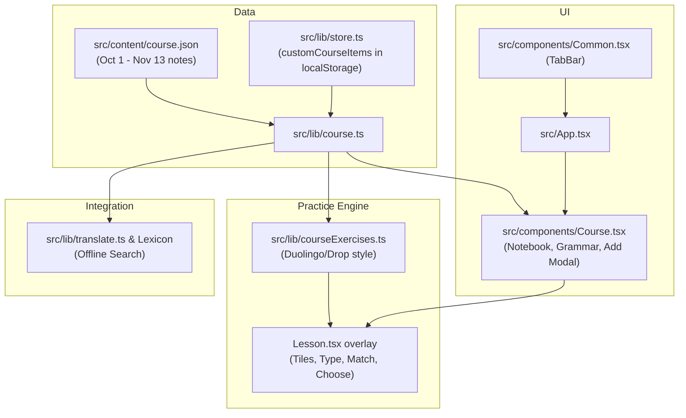

# Mon Cours (Julie) Implementation Plan

> **For agentic workers:** REQUIRED SUB-SKILL: Use superpowers:subagent-driven-development (recommended) or superpowers:executing-plans to implement this plan task-by-task. Steps use checkbox (`- [ ]`) syntax for tracking.

**Goal:** Add a dedicated "Mon cours" section for Julie to read her professor's course notes, practice French ↔ Manglish sentence translation and vocabulary in a playful Duolingo/Drops style, and add new words from future classes.

**Architecture:** A static JSON dataset (`course.json`) models all existing class sessions (dates, vocabulary, 14 verbs with `-o` questions & imperatives, grammar notes like *Und vs Aanu*). A module `course.ts` merges preloaded notes with user-added entries from `store.ts` (`customCourseItems`). A dedicated exercise generator `courseExercises.ts` produces bidirectional translation, word tile assembly, and vocabulary quizzes executed via the existing `Lesson` overlay. A new component `Course.tsx` renders the notebook, grammar sheets, addition modal, and practice launcher, connected to a 6th navigation tab `cours` in `App.tsx`.

**Architecture Diagram:**



**Tech Stack:** React 19, TypeScript 5.8, Vite 6, CSS Variables, LocalStorage, Edge TTS / Audio cache

**Spec:** [docs/superpowers/specs/2026-11-18-mon-cours-design.md](file:///e:/projects/cheri-malayalam/docs/superpowers/specs/2026-11-18-mon-cours-design.md)

## Global Constraints

- Navigation must accommodate 6 tabs smoothly on narrow mobile screens (360px+) without horizontal scroll.
- All course words and sentences must have valid Malayalam script (`ml`) and auto-generated pronunciation hints (`hint`).
- User-added custom items must persist in `localStorage` and be included in JSON backups (`exportProgress` / `importProgress`).
- All exercise types must support Julie's requested example sentences (*"Est-ce que tu as dormi ?"* ↔ *"Ni urangiyo ?"*, *"Aval ivide urangiyo ?"* ↔ *"Est-ce qu'elle a dormi ici ?"*, *"Vérité : sathyam"*, *"kallam : Mensonge"*).
- No new external runtime dependencies; use existing React, Vite, and CSS architecture.

## Review Focus

1. Mobile tab bar overflow: 6 tabs must fit cleanly without truncation or overlapping badge numbers.
2. Bidirectional translation: Sentence translation exercises must generate both FR ➔ ML and ML ➔ FR with matching word tiles.
3. Offline audio resilience: Course sentences with generated MP3 audio play directly; ungenerated sentences fall back gracefully to browser Malayalam speech synthesis without throwing.
4. Custom item reactivity: Adding a new word in "+ Ajouter" must update the active screen and quiz pool immediately without requiring a page reload.
5. Search & filter responsiveness: Filtering course notes by date, category, or search text must correctly filter both preloaded notes and custom entries.

---

### Task 1: Create Course Dataset & Course Lib

**Files:**
- Create: `src/content/course.json`
- Create: `src/lib/course.ts`
- Test: `scripts/test-course-content.mjs`

**Interfaces:**
- Produces: `CourseSession`, `CourseGrammar`, `CourseItem`, `loadCourseData()`, `getCombinedCourseItems(custom: CourseCustomItem[])`

- [ ] **Step 1: Write test script `scripts/test-course-content.mjs` checking course data parsing and items**

```js
import assert from 'node:assert'
import fs from 'node:fs'

const data = JSON.parse(fs.readFileSync('src/content/course.json', 'utf8'))
assert(Array.isArray(data.sessions), 'sessions should be an array')
assert(data.sessions.length >= 7, 'should have at least 7 course dates')
assert(data.grammar && data.grammar.undVsAanu, 'should have undVsAanu grammar')
assert(data.verbs && data.verbs.length >= 14, 'should have 14 verbs table')

// Check specific examples requested by Julie
const allItems = data.sessions.flatMap(s => s.items)
const urangiyo = allItems.find(i => i.manglish.toLowerCase().includes('urangiyo'))
assert(urangiyo, 'Missing "urangiyo" sentence')
const sathyam = allItems.find(i => i.manglish.toLowerCase() === 'sathyam')
assert(sathyam, 'Missing "sathyam" word')
const kallam = allItems.find(i => i.manglish.toLowerCase() === 'kallam')
assert(kallam, 'Missing "kallam" word')
console.log('✅ Course content verified:', allItems.length, 'items across', data.sessions.length, 'sessions')
```

- [ ] **Step 2: Run test to verify it fails initially**

Run: `node scripts/test-course-content.mjs`
Expected: FAIL (file does not exist yet)

- [ ] **Step 3: Create `src/content/course.json` with all transcribed class sessions from Julie's notes**

Populate sessions:
1. `Vocabulaire général - Famille` (Achan, Amma, Chettan, Chechi, Aniyan, Aniyathi, ammayi, ammavan, valyamma, valyachan, Appooppan, Ammoomma)
2. `Cours du 01/10/26 - Les bases` (Njan, Ente, Nee, Ninte, Entha, Peeru, Aate/Aannu, Illa, Vellam, Evide, Sugamano, Sugamanu, Sugamalla, Manasilayo, Manasilayi, Manasilayilla, Ninde peerendha?, Ente peeru Julie, Vellam veno?, Vellam venam, Vellam venda)
3. `Cours du 08/10/26 - Verbes et pronoms` (kazhikkuka, uranguka, kudikkuka, pokuka, pidikkuka, manakkuka, vaanguka, vilikkuka; njan, nee, avan, aval, njangal/nammal, ningal, avar; -unnu, -um)
4. `Cours du 22/10/26 - Verbes, questions en -o et quotidien` (kazhikkuvanu/kazhicho, kudikkuvanu/kudicho, padikkuvanu/padicho, uranguvanu/urangiyo, nadakkuvanu/nadanno; sathyam, sherikkum, kollam, kallam; eppo, evide, engane, aara; office il poyo?, evide pokuva?, urangiyo?; nombres 1-10)
5. `Cours du 29/10/26 - Le corps et la douleur` (kannu, mooku, vaya, nakku, kathu, thala, kai, kaalu, vayaru; vedana, vedanikunnu, thala vedanikunnu; untakuka, undu, undayirunnu, undakum; engane undu?, aara varunne?, eppo ethum?; nombres 11-20)
6. `Cours du 05/11/26 - Conjugaisons & Conversation` (Urangi/Urangunnu/Urangum; Nadannu/Nadakkunnu/Nadakkum; Njan urangi, Avan ivide urangi, Aval urangunnu, Avar ivide urangunnu, Njan urangum, Avan urangum, Aval nadannu, Njan ivide nadannu, Avan nadakkunnu, Avar ivide nadakkunnu, Ni nadakkum, Avar nadakkum; Questions: Avan urangiyo?, Aval urangiyo?, Avar urangiyo?, Ni urangiyo?, Da ni urangiyo?, Di aval urangiyo?, Avan nadanno?, Aval nadanno?, Avar nadanno?, Ni nadanno?, Ni ivide varu, Da ivide varu, Ni kazhicho?, Avan kazhicho?, Aval kazhicho?, Da ni kazhicho?, Di ni kazhicho?, Ninde da/di?, Avan ente..., Aval ivide urangiyo?)
7. `Cours du 12/11/26 - Le temps & expressions` (innu, nale, innale, ippo, aazhcha, masam, varsham, rawile, ucha, vayhunneram, rathri, pinne, pinne etha, veedu, venam, venda; nombres 21-30)
8. `Cours du 13/11/26 - Les 14 verbes et UND vs AANU` (Tableau des 14 verbes avec Infinitif, Présent, Passé, Futur, Question `-o`, Impératif; Leçon complète UND vs AANU avec paires comparatives)

- [ ] **Step 4: Create `src/lib/course.ts` with helper types and lookup functions**

Export:
```ts
export interface CourseItem {
  id: string
  manglish: string
  fr: string
  ml: string
  hint: string
  note?: string
  date?: string
  category?: string
}
export interface CourseVerb {
  inf: string; pres: string; past: string; fut: string; question: string; imperative: string; fr: string
}
export interface CourseSession {
  id: string; date: string; title: string; emoji: string; intro?: string; items: CourseItem[]
}
export function getCourseSessions(): CourseSession[]
export function getAllCourseItems(): CourseItem[]
export function getCombinedCourseItems(custom: CourseCustomItem[]): CourseItem[]
```

- [ ] **Step 5: Run test to verify it passes**

Run: `node scripts/test-course-content.mjs`
Expected: PASS

- [ ] **Step 6: Commit**

```bash
git add src/content/course.json src/lib/course.ts scripts/test-course-content.mjs
git commit -m "feat(course): add Julie course dataset and course parser module"
```

---

### Task 2: Extend Local Store for Custom Course Items

**Files:**
- Modify: `src/lib/store.ts:1-70`
- Test: `scripts/test-store-course.mjs`

**Interfaces:**
- Consumes: `Progress` in `src/lib/store.ts`
- Produces: `CourseCustomItem`, `addCustomCourseItem(item)`, `removeCustomCourseItem(id)`

- [ ] **Step 1: Write test script `scripts/test-store-course.mjs`**

```js
import assert from 'node:assert'
import { createServer } from 'vite'

const server = await createServer({ server: { middlewareMode: true }, appType: 'custom', logLevel: 'error' })
const { getProgress, setProgress, exportProgress, importProgress } = await server.ssrLoadModule('/src/lib/store.ts')

// Add custom course item
const p = getProgress()
assert(Array.isArray(p.customCourseItems || []), 'customCourseItems should default to array')
setProgress(s => ({
  ...s,
  customCourseItems: [...(s.customCourseItems || []), { id: 'custom-1', manglish: 'Chiri', fr: 'Sourire', ml: 'ചിരി', date: '2026-11-20' }]
}))
assert.strictEqual(getProgress().customCourseItems.length, 1)

// Backup & restore retains custom items
const backup = exportProgress()
assert(backup.includes('custom-1'))
assert(backup.includes('Chiri'))

const restored = importProgress(backup)
assert(restored)
assert.strictEqual(getProgress().customCourseItems[0].manglish, 'Chiri')
await server.close()
console.log('✅ Store custom course items verified')
```

- [ ] **Step 2: Run test to verify failure**

Run: `node scripts/test-store-course.mjs`
Expected: FAIL (customCourseItems not in Progress type or fresh state)

- [ ] **Step 3: Update `src/lib/store.ts`**

Add `CourseCustomItem` interface and include `customCourseItems: CourseCustomItem[]` in `Progress` interface, `fresh` default object, and backup serialization.

- [ ] **Step 4: Run test to verify it passes**

Run: `node scripts/test-store-course.mjs`
Expected: PASS

- [ ] **Step 5: Commit**

```bash
git add src/lib/store.ts scripts/test-store-course.mjs
git commit -m "feat(store): add customCourseItems to Progress and backup serialization"
```

---

### Task 3: Interactive Duolingo/Drop Style Quiz Engine for Julie's Course

**Files:**
- Create: `src/lib/courseExercises.ts`
- Test: `scripts/test-course-exercises.mjs`

**Interfaces:**
- Consumes: `CourseItem` from `src/lib/course.ts`, `Exercise` from `src/lib/exercises.ts`
- Produces: `courseExercises(items: CourseItem[], count?: number): Exercise[]`

- [ ] **Step 1: Write test script `scripts/test-course-exercises.mjs`**

```js
import assert from 'node:assert'
import { createServer } from 'vite'

const server = await createServer({ server: { middlewareMode: true }, appType: 'custom', logLevel: 'error' })
const { getCombinedCourseItems } = await server.ssrLoadModule('/src/lib/course.ts')
const { generateCourseExercises } = await server.ssrLoadModule('/src/lib/courseExercises.ts')

const items = getCombinedCourseItems([])
assert(items.length > 50)
const exercises = generateCourseExercises(items, 15)
assert(exercises.length === 15)

// Must have sentence building tiles, translation to Manglish, translation to French, and match
const kinds = new Set(exercises.map(e => e.kind))
assert(kinds.has('toMl') || kinds.has('build'), 'Must have toMl or build')
assert(kinds.has('toFr'), 'Must have toFr')

// Check Julie example specifically: Est-ce que tu as dormi ? -> Ni urangiyo ?
const urangiEx = generateCourseExercises(items.filter(i => i.manglish.includes('urangiyo')), 2)
assert(urangiEx.length > 0)
await server.close()
console.log('✅ Course exercise generator verified')
```

- [ ] **Step 2: Run test to verify failure**

Run: `node scripts/test-course-exercises.mjs`
Expected: FAIL (module does not exist)

- [ ] **Step 3: Implement `src/lib/courseExercises.ts`**

Generate exercises that focus specifically on:
1. Sentence translation from French ➔ Manglish (with word tile builder when multi-word, e.g. *Ni urangiyo ?*, *Aval ivide urangiyo ?*).
2. Translation from Manglish ➔ French (choose correct French meaning).
3. Vocabulary pairs (e.g. *Sathyam* = *Vérité*, *Kallam* = *Mensonge*, body parts, family).
4. Audio listening exercises.

- [ ] **Step 4: Run test to verify it passes**

Run: `node scripts/test-course-exercises.mjs`
Expected: PASS

- [ ] **Step 5: Commit**

```bash
git add src/lib/courseExercises.ts scripts/test-course-exercises.mjs
git commit -m "feat(course): implement Duolingo-style course exercise generator"
```

---

### Task 4: Create "Mon cours" UI Component (`Course.tsx`)

**Files:**
- Create: `src/components/Course.tsx`
- Modify: `src/index.css` (course view and notebook card styling)

**Interfaces:**
- Consumes: `src/lib/course.ts`, `src/lib/store.ts`, `src/lib/audio.ts`
- Produces: `<Course onStartPractice={(items: CourseItem[]) => void} />`

- [ ] **Step 1: Build `src/components/Course.tsx`**

Sections:
1. **Header / Hero:**
   - Title: "Mon cours de malayalam"
   - Subtitle: "Les cours de Julie avec son professeur"
   - Action buttons:
     - Primary: `▶ S'entraîner sur mon cours` (launches interactive Duolingo-style quiz)
     - Secondary: `+ Ajouter un mot / une phrase` (opens modal)
2. **Search & Filter Bar:**
   - Search input (searches French, Manglish, notes)
   - Filter pills: `Tous`, `Par cours`, `Verbes & -o`, `Und vs Aanu`, `Vocabulaire`, `Mes ajouts`
3. **Grammar & Verb Reference Cards:**
   - Dedicated card for **UND vs AANU** with the comparison table and clear rules
   - Dedicated card for **Questions en -o** with examples (*Kazhicho?*, *Urangiyo?*, *Nadanno?*)
   - Dedicated table for the 14 verbs across all tenses and forms
4. **Chronological Course Accordions:**
   - Cards grouped by course date (1/10, 8/10, 22/10, 29/10, 5/11, 12/11, 13/11)
   - Audio speaker buttons on every phrase and word
   - Display Manglish, French, Malayalam script, and pronunciation hints
5. **Add Word/Sentence Modal:**
   - Form fields: French (required), Manglish (required), Malayalam (optional auto-filled or manual), Note (optional), Date (defaults to today)
   - Saves to `store.ts` `customCourseItems` and immediately reflects in the list and practice pool

- [ ] **Step 2: Add CSS rules in `src/index.css`**

Add styling for `.course-page`, `.course-hero`, `.course-filters`, `.course-section`, `.course-card`, `.grammar-box`, `.verb-table-wrap`, and `.add-modal`.

- [ ] **Step 3: Test compilation with TypeScript**

Run: `node -e "import('./src/components/Course.tsx')"`
Expected: Compiles with no syntax or type errors.

- [ ] **Step 4: Commit**

```bash
git add src/components/Course.tsx src/index.css
git commit -m "feat(course): create Course component with notebook, grammar sheets, and add modal"
```

---

### Task 5: Integrate Tab Bar & App Navigation

**Files:**
- Modify: `src/components/Common.tsx:38-55`
- Modify: `src/App.tsx:1-107`
- Modify: `src/index.css:121-130,456-475` (responsive 6-tab layout for mobile)

**Interfaces:**
- Consumes: `<Course />` from `src/components/Course.tsx`
- Produces: Tab `'cours'` in `TabBar`, overlay management for course practice session

- [ ] **Step 1: Update `Common.tsx`**

Add `'cours'` to `Tab` union and `TABS` array:
```ts
export type Tab = 'learn' | 'cours' | 'dialogues' | 'practice' | 'lexicon' | 'profile'
const TABS: [Tab, string, string][] = [
  ['learn', '🏝️', 'Apprendre'],
  ['cours', '📝', 'Mon cours'],
  ['dialogues', '💬', 'Dialogues'],
  ['practice', '🎯', 'Entraînement'],
  ['lexicon', '🔤', 'Traduire'],
  ['profile', '👤', 'Profil'],
]
```

- [ ] **Step 2: Update `App.tsx`**

Add route for `tab === 'cours'` rendering `<Course onStartPractice={items => startCoursePractice(items)} />`.
Handle `startCoursePractice` by triggering the existing `Lesson` overlay with `generateCourseExercises(items)`.

- [ ] **Step 3: Update `index.css` for 6-tab mobile layout**

Ensure `.tabbar button` padding and text sizing adapts smoothly on small phone screens (e.g. max-width 70px, `.tl` font-size 10px on small screens, flex sizing).

- [ ] **Step 4: Verify whole app build**

Run: `npm.cmd run build`
Expected: PASS with 0 errors.

- [ ] **Step 5: Commit**

```bash
git add src/components/Common.tsx src/App.tsx src/index.css
git commit -m "feat(navigation): integrate Mon cours 6th tab and practice session launcher"
```

---

### Task 6: Audio Generation & Translator Integration

**Files:**
- Modify: `scripts/check-content.mjs`
- Modify: `scripts/gen-audio.mjs`
- Modify: `src/lib/content.ts` (include course items in `searchItems` and `sourceOf`)

**Interfaces:**
- Produces: Audio MP3 files for new course phrases in `public/audio/`, indexes course items in translator search.

- [ ] **Step 1: Update `src/lib/content.ts`**

Import course items and include them in `searchItems` so the offline French ↔ Manglish translator can find every word and sentence from Julie's course notes.

- [ ] **Step 2: Run audio generation for missing course phrases**

Run: `node scripts/gen-audio.mjs`
Expected: Generates MP3s for all new course phrases and words using Microsoft Malayalam neural voices (`ml-IN-SobhanaNeural` / `ml-IN-MidhunNeural`).

- [ ] **Step 3: Verify content check passes**

Run: `node scripts/check-content.mjs`
Expected: PASS (Contenu OK)

- [ ] **Step 4: Commit**

```bash
git add src/lib/content.ts scripts/check-content.mjs scripts/gen-audio.mjs public/audio/
git commit -m "feat(course): integrate course items into offline translator search and audio"
```

---

### Task 7: Verification and End-to-End Testing

**Files:**
- Create: `scripts/test-mon-cours-e2e.mjs`

- [ ] **Step 1: Write automated end-to-end test script `scripts/test-mon-cours-e2e.mjs`**

Verify:
1. Julie's exact test sentences are present and produce valid quiz exercises:
   - *"Est-ce que tu as dormi ?"* ↔ *"Ni urangiyo ?"*
   - *"Aval ivide urangiyo ?"* ↔ *"Est-ce qu'elle a dormi ici ?"*
   - *"Vérité"* ↔ *"sathyam"*
   - *"Mensonge"* ↔ *"kallam"*
2. 14 verbs are loaded with present, past, future, `-o` question, and imperative forms.
3. Grammar lesson *Und vs Aanu* loads with all 3 comparison pairs.
4. Adding a custom item into `store.ts` reflects in `getCombinedCourseItems()` and generates quiz tiles.
5. Export/import retains custom items.
6. Build and TypeScript check pass cleanly (`npm run build`).

- [ ] **Step 2: Run end-to-end test script**

Run: `node scripts/test-mon-cours-e2e.mjs`
Expected: PASS

- [ ] **Step 3: Run production build**

Run: `npm.cmd run build`
Expected: PASS

- [ ] **Step 4: Commit and deploy**

```bash
git add scripts/test-mon-cours-e2e.mjs
git commit -m "test(course): verify Mon cours end-to-end functionality"
npx wrangler deploy
```
